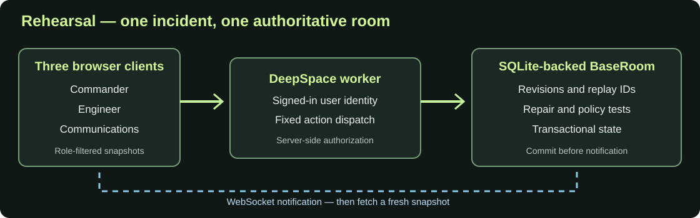

# Rehearsal

**Don't just suggest the fix. Prove it works.**

[**Launch the live app**](https://rollcall-pavel.app.space/) · [**Start a drill**](https://rollcall-pavel.app.space/rehearsal-studio) · [**Browse released code**](https://rollcall-pavel.app.space/rehearsal-source/) · [**Demo walkthrough**](docs/demo.md)

Rehearsal is a multiplayer incident-response simulator. Three signed-in teammates investigate a **fictional** software failure, edit and test a real JavaScript repair, review the exact change, and verify recovery before a customer update. A solo mode lets you learn the same workflow without teammates.

> An AI assistant can suggest a patch. Rehearsal trains the part that follows: what input proves the old function was wrong, who reviewed the fix, and what did the team actually verify?

## See it in under five minutes

1. Sign in, open the [incident studio](https://rollcall-pavel.app.space/rehearsal-studio), and choose **Runaway AI pricing agent**.
2. Start **Solo** for a quick trial, or create a **Team** room and privately invite an Engineer and Communications teammate.
3. Inspect simulated logs. Try the starter JavaScript and show that an unapproved price change is accepted.
4. Repair the function and JSON guardrails. Run **8 behavioral cases** and **6 configuration checks**.
5. Submit, document the commander's review, approve, apply, reverify, publish the simulated customer update, and read the debrief.

See the [90-second demo script and exact verification steps](docs/demo.md). The silent subtitled MP4 is provided with the internship submission rather than hosted in this repository.

## Architecture



| Layer | What it guarantees |
| --- | --- |
| React + TypeScript | Role-specific interface for evidence, editor, guardrails, review, chat and debrief |
| DeepSpace authentication + worker actions | Server verifies the caller and forwards only fixed room operations |
| DeepSpace BaseRoom + SQLite | One Durable Object owns an incident's authoritative state |
| Revision checks + request IDs | Stale decisions are rejected and retries do not repeat an accepted action |
| WebSockets + snapshots | Notify after commit; reconnecting browsers retrieve a fresh role-filtered view |
| Restricted JavaScript interpreter | Test authored repairs on the server without arbitrary JavaScript execution |

Key files: [room authority](src/rehearsal/studio-room.ts), [state machine](src/rehearsal/studio/engine.ts), [repair evaluator](src/rehearsal/studio/repair.ts), [authenticated collaboration tests](tests/studio-collab.spec.ts).

## Seven incident drills

Checkout saturation · Traffic surge · Exposed credentials · Runaway AI pricing · Duplicate charges · Stale database replicas · Over-broad notification campaign.

All outages, customer data, impact figures and recovery scores are simulated. No real infrastructure is modified.

## Run it locally

Use **Node 24** and npm. DeepSpace-specific tests and local app development also require the relevant signed-in SDK environment.

```bash
npm ci
npm run type-check
npm run test:unit
npm run build
```

```bash
npm run dev                     # DeepSpace local development
npx deepspace test run all      # official platform suite, requires auth
```

GitHub Actions runs the type-check, unit test and production-build checks for pull requests. Those checks do **not** replace the authenticated multi-account platform test.

## Evidence and limitations

The [release-review record](docs/release-review.md) distinguishes the **reported** DeepSpace release-6 test results from tests any reviewer can reproduce. The published release was reported at commit `6af91a66f3062a1be6db82de885bd2f5af58c4cc`; later GitHub-only changes are **not automatically deployed**. Reverify the source commit after any deployment.

The editor supports a bounded subset of JavaScript, not arbitrary programs. Eight passing cases demonstrate the exercise's specified behavior, not proof for every input. Server-side replay ledgers have explicit per-room activity budgets; account-level room-creation quotas remain future platform hardening. The default coach provides authored hints, and the optional paid AI integration was not enabled in the recorded release. Screen-reader testing, physical devices, Safari and load tests were not independently verified.

## Contribution and AI assistance

I chose the incident-response concept, directed the three-role workflow and product requirements, and insisted on real code repairs, test evidence, and using the original DeepSpace project. **Codex contributed extensively** to implementation, debugging, automated tests, deployment work and the video. Commit history retains actual attribution. I can explain the design decisions and outstanding limitations in a live technical discussion.

[Submission write-up](docs/submission.md) · [Release review](docs/release-review.md) · [Demo guide](docs/demo.md)
